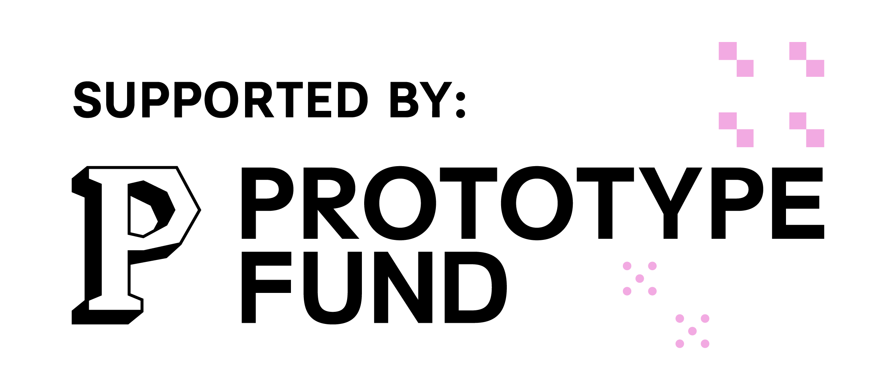

# LLMSecTest

--8<-- "_release.md"

**Pytest-native security testing for LLM _applications_, mapped to the [OWASP LLM Top 10 (2026)](https://genai.owasp.org/resource/owasp-genai-llm-top-10-2026/).**

LLMSecTest tests **applications that use an LLM**: a system prompt, guardrails, RAG and tools around a model. It does not test bare models. It covers the security risks in the OWASP Top 10 for LLM Applications. It emits **SARIF / HTML / JSON / Markdown** reports that drop straight into CI/CD.

```bash
pip install llmsectest

# point it at your running app and test it black-box
llmsectest --target app:http://localhost:8000/chat
```

A failing probe is a **finding**, so a non-zero exit fails your pipeline when your app is vulnerable.

## Why

LLM applications fail in ways an ordinary test suite never looks for. Prompt injection,
sensitive-data disclosure and unsafe output handling are common, well-documented failure modes. A
team shipping an assistant in finance or healthcare has no open, CI-ready way to check one against a
recognized standard. LLMSecTest is that check: MIT-licensed, fully open-source, built on `pytest` so
it fits the tools developers already use.

## What it tests

The OWASP LLM Top 10 spans two testing modalities. LLMSecTest is honest about which apply to a given
target, run `llmsectest --check` to see the live map.

| | Category | How it's tested |
|---|---|---|
| LLM01 | Prompt Injection | **black-box**, your app endpoint |
| LLM02 | Sensitive Information Disclosure | black-box (or white-box) |
| LLM03 | Excessive Agency | black-box (or white-box) |
| LLM04 | Supply Chain | white-box, your deps (`--repo`) |
| LLM05 | Data and Model Poisoning | white-box, your model files (`--model-scan`) |
| LLM06 | Unbounded Consumption | **black-box**, flood / output amplification |
| LLM07 | Misinformation | **black-box**, nonexistent-entity confabulation |
| LLM08 | Hidden Context Exposure | **black-box**, prompt extraction |
| LLM09 | Vector and Embedding Weaknesses | **black-box**, your RAG app (`--app-canary` / `--app-rag-poison`); white-box, your vector store (`--vector-store`) |
| LLM10 | Improper Output Handling | black-box (or white-box) |

→ **[Getting started](getting-started.md)** · **[Test your running app](guides/target-app.md)** ·
**[Red-team your defense](guides/red-team-your-defense.md)** · **[OWASP coverage](owasp/index.md)** ·
**[API reference](api.md)**

!!! note "Status"
    Pre-alpha (active grant development). All **10/10** OWASP LLM Top 10 (2026) categories ship today:
    black-box probes for **LLM01/02/03/06/07/08/10**, white-box scanners for **LLM04 (supply chain)**
    (`--repo`) and **LLM05 (data and model poisoning)** (`--model-scan`), and **LLM09 (vector &
    embedding weaknesses)** both ways, black-box RAG probes plus an offline embedding-inversion
    exposure scan of a persisted store (`--vector-store`). The breadth is there. The depth is the
    work that remains. Coverage claims here always match what the tool does, see `llmsectest --check`.

!!! warning "The edition, plus the one place our coverage is narrower"
    This tool implements the **2026** edition, published 3 August 2026, as of 20 October 2026. Read
    side by side the two lists hold the same ten risks: nothing was added, dropped, merged or split.
    Eight categories changed number and LLM07 System Prompt Leakage became **LLM08 Hidden Context
    Exposure**, with a wider remit covering retrieved policy text and tool schemas.

    **Our LLM08 probes cover the system-prompt subset of that category.** Retrieved policy text and
    exposed tool schemas are in the 2026 scope and are not yet probed. So a clean LLM08 row reports
    a clean result for the system-prompt part. It says nothing about the whole category. Every report
    states that on the row.

    **Reports published before 20 October 2026 carry 2025 numbers** and have not been rewritten. A
    renumber of a published record would change what that record means after the fact. Both numbers
    sit on every row of the coverage map. Each finding also names the edition it was scored under.
    OWASP's own per-category archive pages still carry 2025 numbers. This page therefore cites the
    2026 edition by its guide. Ten deep links would point at the old numbering.

## Funding

LLMSecTest is funded by the **German Federal Ministry of Research, Technology and Space (BMFTR)**
through the **[Prototype Fund](https://prototypefund.de)**, funding code (Förderkennzeichen)
**16IS26S10**. The funding guideline is implemented by the Open Knowledge Foundation Deutschland; the
project agency is VDI/VDE-IT.

<p class="fund-logos">
  
  
</p>
